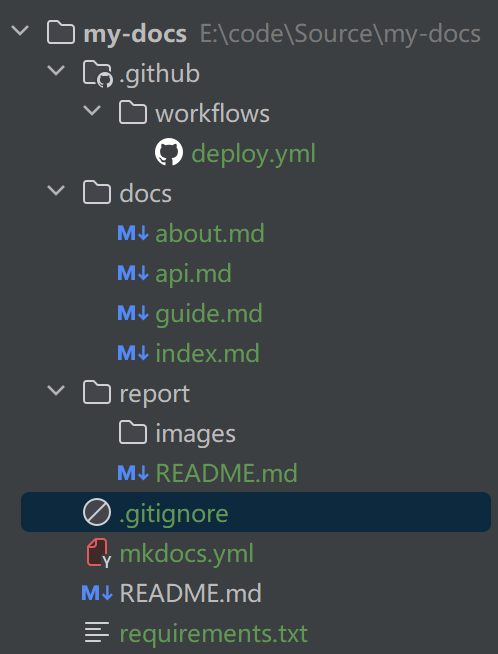
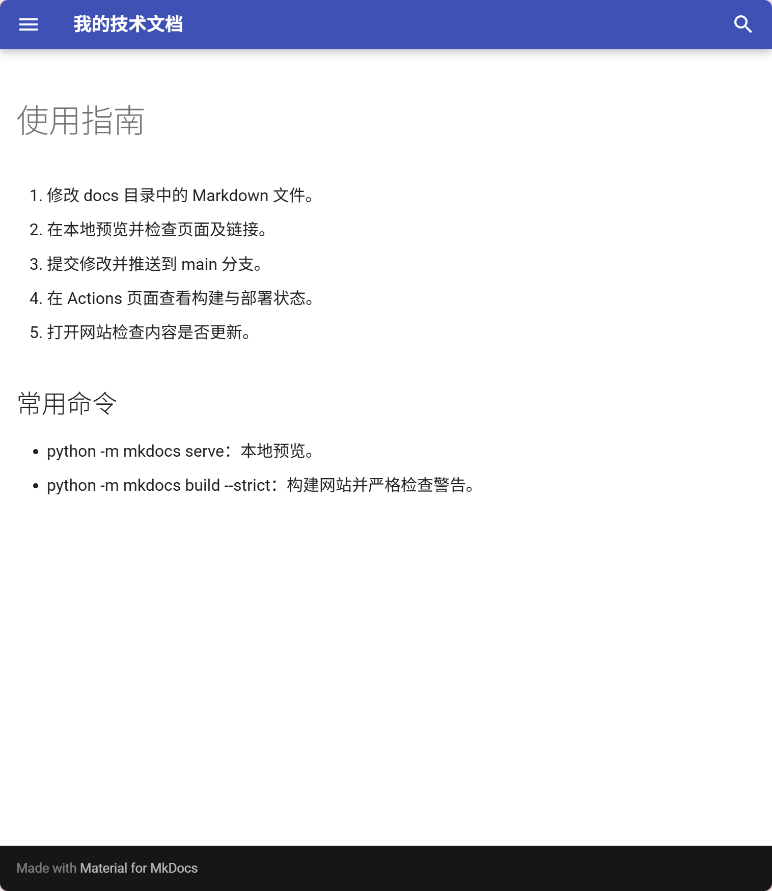
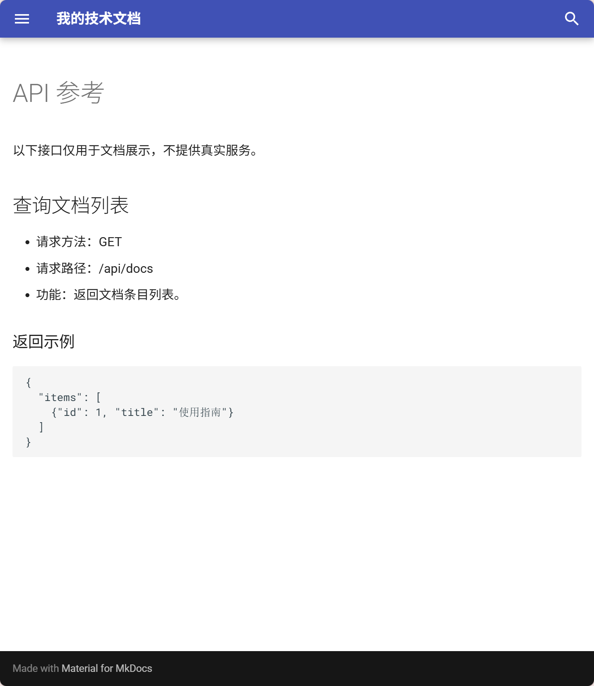
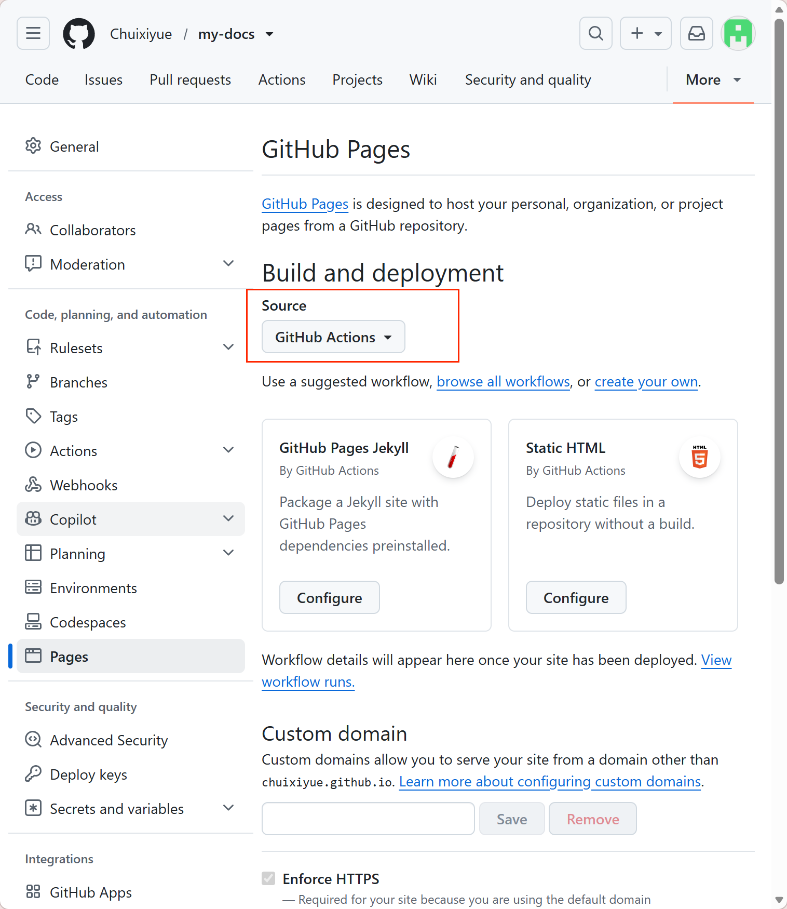

# 实践项目2：个人实验报告

## 1. 基本信息
- GitHub 登录名：Chuixiyue
- 个人仓库地址：https://github.com/Chuixiyue/my-docs
- 最终网站地址：

## 2. 实践过程与关键截图
### 2.1 仓库创建
GitHub 网页新建公开仓库 `my-docs`

### 2.2 项目结构与 MkDocs 配置
本截图展示项目目录与 `mkdocs.yml` 配置；
 `docs` 是 Markdown 源码目录，存放我们编写的文档；`nav` 配置网站导航菜单，定义页面跳转；`site/` 是构建生成的静态网站文件，由 MkDocs 自动产出，不手动编辑。

### 2.3 本地构建或预览

本次本地预览，依次打开首页、关于、使用指南、API 参考四个页面：
1. 检查导航栏跳转是否正常，页面之间的链接能否互相访问；
2. 检查表格格式、代码块样式是否正常渲染；
3. 核对文档文字内容，确认没有缺失、乱码；
4. 确认无报错页面，网站可以正常浏览。
测试完毕后按下 `Ctrl + C` 终止本地预览服务。

### 2.4 Pages 设置

### 2.5 Actions 首次构建和部署
### 2.6 网站访问与四页导航检查
### 2.7 第二次推送与自动更新验证
- 对应提交链接：
- 对应 Actions 运行链接：

## 3. 问题与解决
记录实际现象、关键日志、原因和解决操作。
如没有遇到错误，说明你核对过哪些日志和配置。

## 4. 原理理解
1. docs/ 和 site/ 各保存什么？为什么不用手工修改 site/？
2. 本次工作流在什么情况下自动运行？
3. build 与 deploy 两个任务有什么区别？
4. 只修改 report/README.md 会触发部署吗？为什么？
5. 本次方案为何无需创建 gh-pages 分支？