# 实践项目2：个人实验报告

## 1. 基本信息
- GitHub 登录名：Chuixiyue
- 个人仓库地址：https://github.com/Chuixiyue/my-docs
- 最终网站地址：https://chuixiyue.github.io/my-docs/

## 2. 实践过程与关键截图
### 2.1 仓库创建
GitHub 网页新建公开仓库 `my-docs`
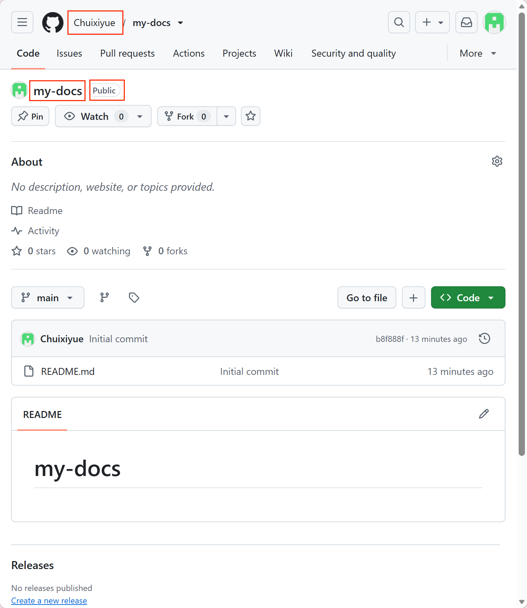

### 2.2 项目结构与 MkDocs 配置
本截图展示项目目录与 `mkdocs.yml` 配置；
 `docs` 是 Markdown 源码目录，存放我们编写的文档；`nav` 配置网站导航菜单，定义页面跳转；`site/` 是构建生成的静态网站文件，由 MkDocs 自动产出，不手动编辑。

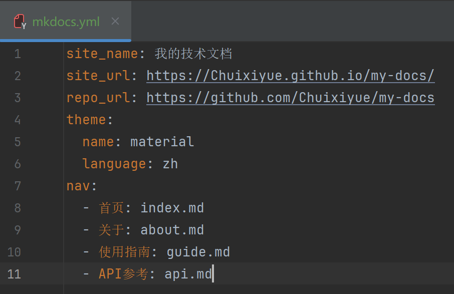

### 2.3 本地构建或预览
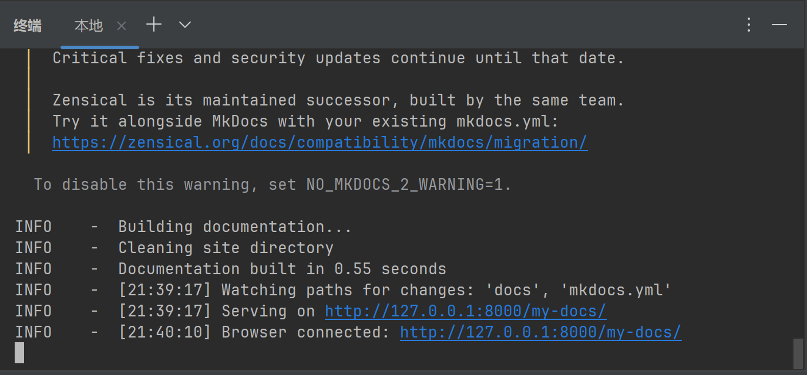
本次本地预览，依次打开首页、关于、使用指南、API 参考四个页面：
1. 检查导航栏跳转是否正常，页面之间的链接能否互相访问；
2. 检查表格格式、代码块样式是否正常渲染；
3. 核对文档文字内容，确认没有缺失、乱码；
4. 确认无报错页面，网站可以正常浏览。
测试完毕后按下 `Ctrl + C` 终止本地预览服务。

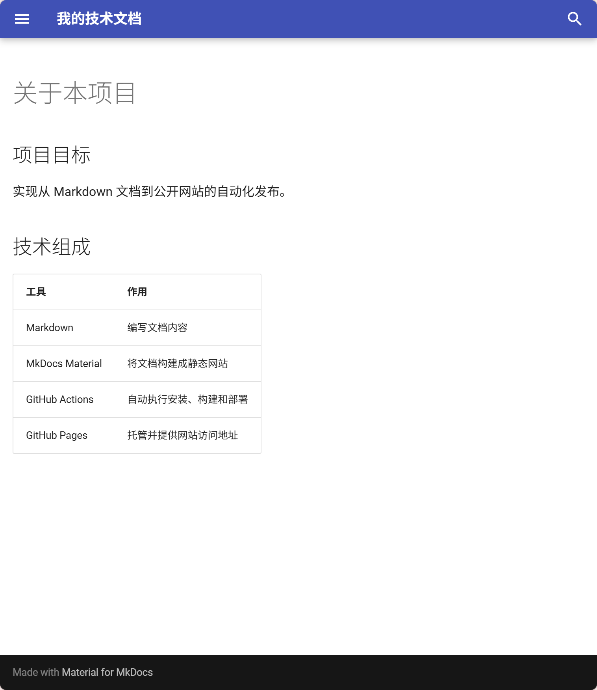

### 2.4 Pages 设置
设置 Pages 发布来源为GitHub Actions。

### 2.5 Actions 首次构建和部署
build 和 deploy 均成功。
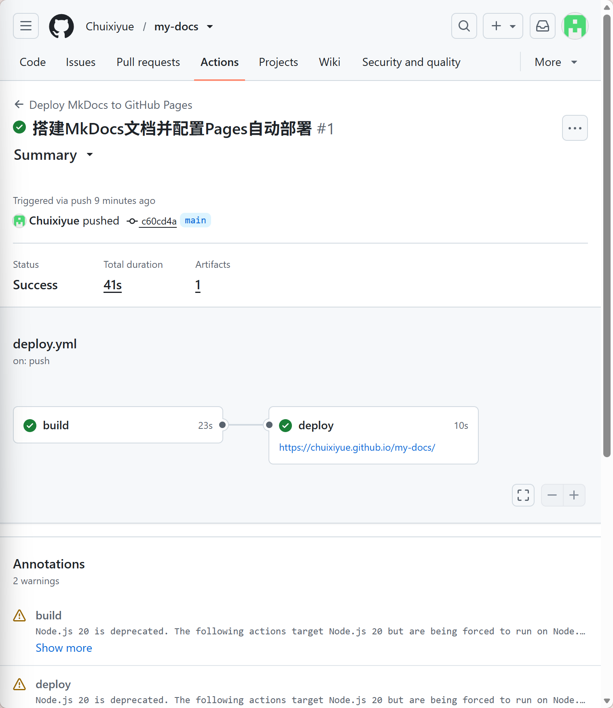

### 2.6 网站访问与四页导航检查
发布完成，使用浏览器访问网站，逐一打开首页、关于、使用指南和 API 参考，确认资源加载、导航及链接正常。
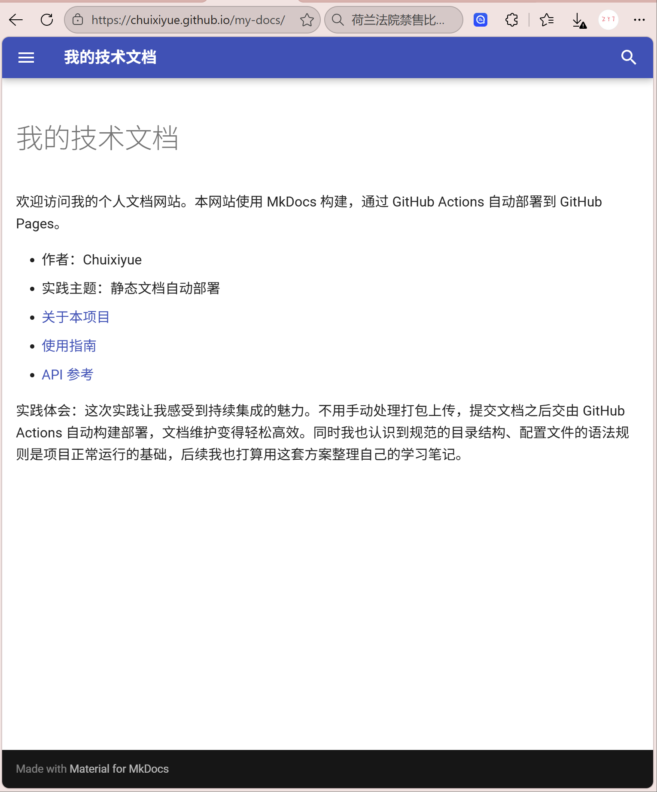
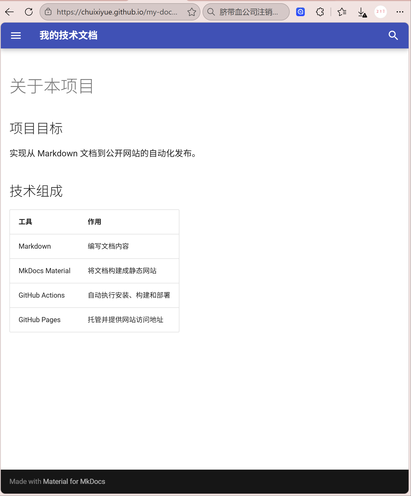
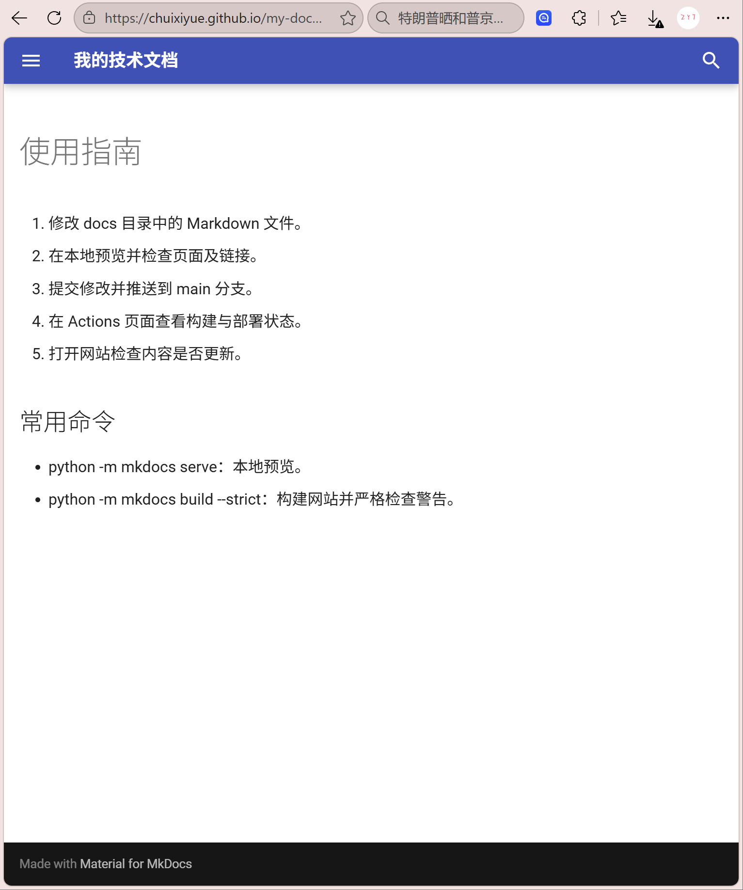
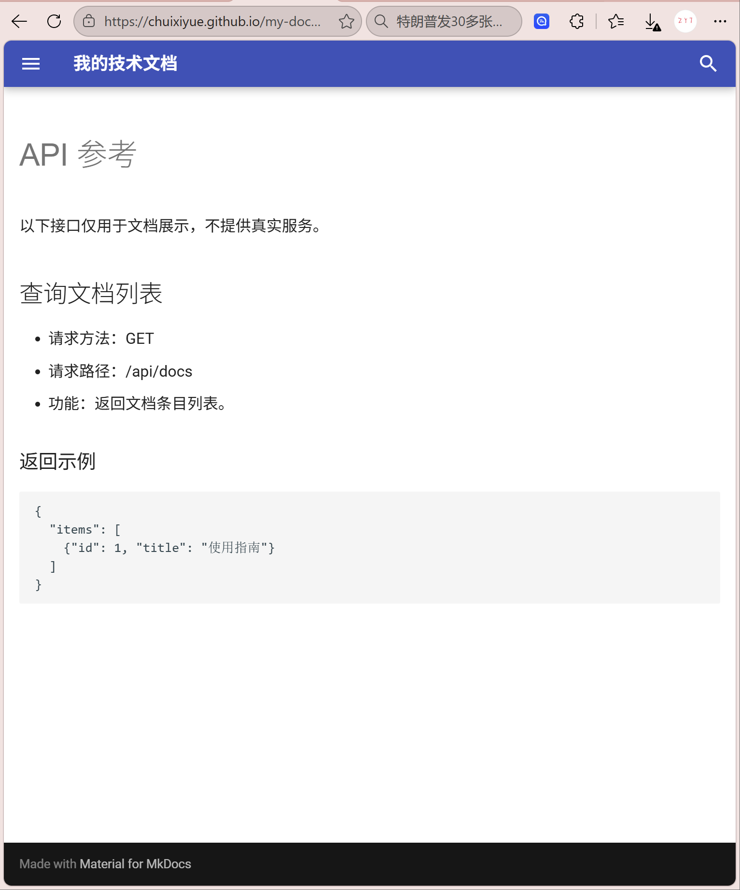

### 2.7 第二次推送与自动更新验证
- 对应提交链接：https://github.com/Chuixiyue/my-docs/commit/bcbb60d559c68ff466fc22f64763acac8adab1b2
- 对应 Actions 运行链接：https://github.com/Chuixiyue/my-docs/actions/runs/45036895942
再修改一次，证明能够自动更新，截图：第二次 push 触发的成功运行记录，以及网站出现新增文字的效果。
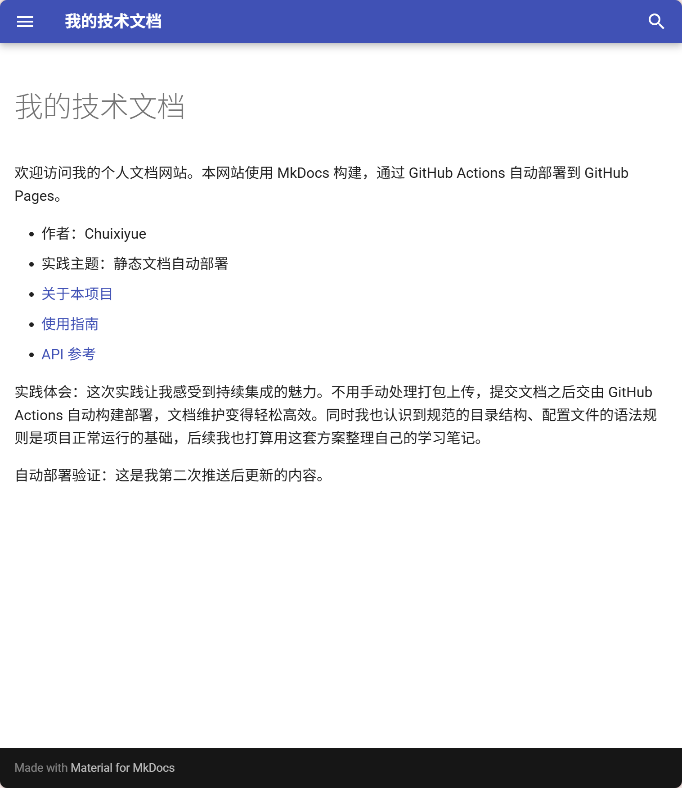
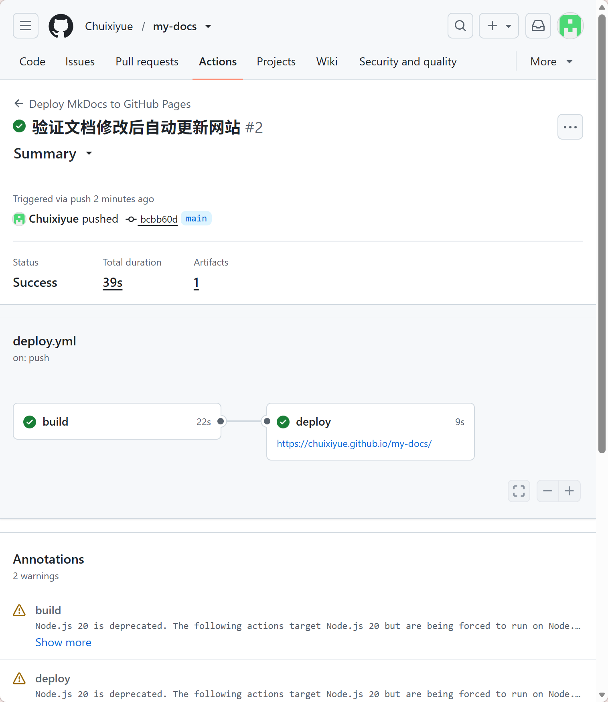

## 3. 问题与解决
本次遇到中文图片文件名编码问题：混入中文截图后 Git 出现转义字符，易导致部署失败。使用`git restore --staged report/`取消暂存，仅重新添加英文命名截图，清理异常文件。
其余流程无报错，核对了 mkdocs 配置文件、workflow 工作流配置、Actions 运行日志，通过`git diff --staged`校验暂存文件，确认无缓存、编译产物等无关文件。

## 4. 原理理解
1. docs/ 和 site/ 各保存什么？为什么不用手工修改 site/？
**docs/** 存放 Markdown 源文档，是编辑维护的源码；**site/** 是 mkdocs 构建输出的静态网页。site / 为编译产物，每次构建会被覆盖，手动修改内容会丢失，因此不手工改动。
2. 本次工作流在什么情况下自动运行？
工作流监听 main 分支，**向 main 分支 push 推送代码时自动运行**。
3. build 与 deploy 两个任务有什么区别？
build：根据源文件编译生成静态网页资源；deploy：将构建产物发布到 GitHub Pages，对外提供访问。先执行 build，成功后才执行 deploy。
4. 只修改 report/README.md 会触发部署吗？为什么？
**会触发部署**。工作流触发条件是 push 到 main 分支，没有设置路径过滤，只要推送代码，无论修改 report 还是 docs 下文件都会启动流水线。
5. 本次方案为何无需创建 gh-pages 分支？
新版`actions/deploy-pages`工具可在流水线执行时**自动生成并维护 gh-pages 分支**，无需用户提前手动创建。